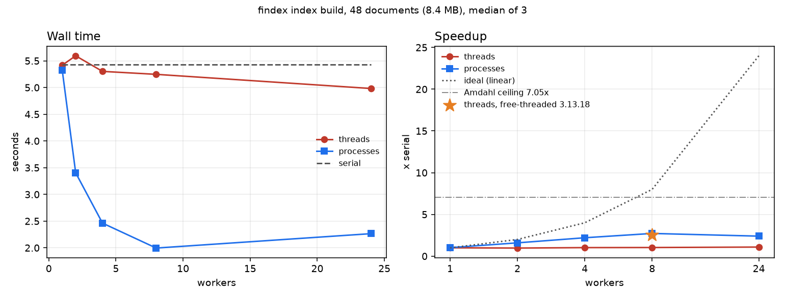

# findex

Пошукова система на Python, зроблена по лабораторних: від читання корпусу до
веб-сервісу. Кожна лабораторна додає один-два модулі, результати вимірювань
лежать у `bench/labN_results.json`, перезібрати їх можна командою
`uv run python bench/labN.py`.

## Як запустити

```bash
uv sync
uv run python download_books.py          # завантажити корпус у data/
uv run pytest -q                         # тести
uv run findex index data --out index.pkl # побудувати індекс
uv run findex search index.pkl "war AND peace"
uv run findex serve                      # http://127.0.0.1:8000
```

## Корпус

Project Gutenberg, 120 текстових файлів, 74,7 МБ. Список з назвами і розмірами
лежить у `corpus_manifest.md`. Завантажує `download_books.py`: до 120 книг,
пауза 1 секунда між запитами, недоступні книги пропускаються, тому набір може
відрізнятися між запусками. Каталог `data/` у `.gitignore`.

## Структура

```
src/findex/
  corpus.py  tokenize.py  stats.py  eager.py   лаб 1
  index.py   search.py    store.py             лаб 2
  query.py   ranking.py   snippet.py           лаб 3
  cli.py     decorators.py                     лаб 4
  crawl.py                                     лаб 6
  web/                                         лаб 7
  vector.py                                    лаб 8
bench/         бенчмарки: labN.py і labN_results.json
tests/         414 тестів
docs/figures/  графік і скриншоти
```

## Лабораторна 1. Потокове читання корпусу

Треба було читати корпус, не тримаючи його в пам'яті. `findex/corpus.py` містить
генератор `iter_documents(root)`: відкриває один файл, віддає
`Document(doc_id, path, text)`, переходить до наступного. Працює з деревом
`.txt` і з `.jsonl`/`.jsonl.gz`. Якщо файл не в UTF-8, він читається з
`errors="replace"`, запуск не падає.

`findex/tokenize.py`: NFC, `casefold`, потім `re.finditer` по `[^\W_]+`.
Апострофи і дефіси всередині слова зберігаються, цифри теж. `findex/stats.py`
рахує `Counter` за один прохід.

Результат на 120 книгах (12 524 563 токени, 278 669 термів):

| Версія | Пік пам'яті | Час |
|---|---:|---:|
| eager, `findex/eager.py` | 768 МіБ | 47,0 с |
| lazy | 137 МіБ | 48,5 с |

Eager тримає всі тексти і всі токени списками, тому пам'яті треба у 5,6 раза
більше. Час однаковий, бо робота однакова: обидві версії читають ті самі файли
і токенізують той самий текст.

Пік lazy не залежить від розміру корпусу. Одна найбільша книга (`pg200.txt`,
8,3 МБ) дає 124,6 МіБ, тобто 91% піку всього запуску, решта припадає на
словник. Найдорожча стадія — `casefold`: 124,6 МіБ на текст книги проти
36,4 МіБ на ASCII-рядок тієї ж довжини.

Висновок: генератори дають виграш у пам'яті, а не в часі.

## Лабораторна 2. Інвертований індекс

Індекс будується за один прохід: `iter_documents` → `tokenize` → `Counter` на
документ → постинги. На 120 книгах виходить 1 038 436 постингів на 278 669
термів.

Постинги можна зберігати трьома способами:

| Подання | Пік при побудові | Файл | Завантаження |
|---|---:|---:|---:|
| `@dataclass` без slots | 211,7 МБ | 26,1 МБ | 2,05 с |
| `@dataclass(slots=True)` | 186,1 МБ | 22,1 МБ | 5,28 с |
| `array('I')` | 156,8 МБ | 19,6 МБ | 0,79 с |

Різниця — це ціна об'єктів `Posting`. `array('I')` зберігає ті самі числа без
об'єктів, тому файл менший і читається швидше.

Формати: pickle (22,1 МБ, завантаження 6,4 с) і json (11,3 МБ, 3,79 с). JSON
менший, але не зберігає `array`, після завантаження постинги стають списками.

Булевий пошук: перетин двох відсортованих списків (merge) і варіант на `set`.
На частих термах це 0,045 і 0,038 мс, на рідкісних — 0,008 і 0,013 мс. Виграш
залежить від довжини списків, а не від самого алгоритму.

## Лабораторна 3. Ранжування, запити, снепети

Додано TF-IDF і BM25, парсер запитів (AND/OR/NOT, дужки, фрази) і снепети.

Перевірки:

- рідкісний терм піднімає свій документ: `accreted` (df=1) у BM25 отримує 5,51
  проти 1,51 у найкращого документа з частим словом, у TF-IDF — 6,24 проти 2,57;
- фраза точніша за AND: `father brown` як AND знаходить 84 документи, як
  фраза — 2;
- BM25 враховує довжину: `shrunk` у документі на 5 079 токенів отримує 2,47, у
  документі на 1 346 412 токенів — 0.22. TF-IDF в обох випадках дає 1.42.

precision@5 на 10 розмічених запитах: 0,90 в обох скорерів. MRR: 0,883 у TF-IDF
і 0,920 у BM25.

Позиції (потрібні для фраз) коштують дорого: індекс 76,6 МБ проти 22,1 МБ,
побудова 238 с проти 197 с.

Кеш запитів дає 2,37 раза на повторних запитах (152,1 → 64,1 мкс).
`heapq.nlargest` виграє на великих n: 6,27 раза на 1 млн документів, а на 1 000
програє (0,51).

## Лабораторна 4. Типи, тести, пакування, CLI

`findex` став встановлюваною командою на `typer`, `src/` проходить `pyright` у
strict без помилок і без `# type: ignore`. Тести на `pytest`, частина
властивостей на `hypothesis`.

| Показник | Значення |
|---|---:|
| тестів | 238 |
| покриття | 95,1% |
| wheel | 53,9 КБ |
| старт `findex --help` | 635 мс |
| `search --format json` | 1403 байти проти 2736 у текстовому |

Зараз у проєкті 414 тестів, решта додані в лабораторних 5–8.

## Лабораторна 5. GIL, потоки, процеси

Побудову індексу розділено на `build_partial` (один документ) і `merge`
(зшивання). У CLI з'явилися `--executor {serial,threads,processes}` і
`--workers`.

48 книг, 8,4 МБ:

| Виконавець | Воркери | Прискорення |
|---|---:|---:|
| threads | 8 | 1,04 |
| processes | 8 | 2,72 |

Потоки нічого не дають, бо токенізація виконується в Python і тримає GIL.
Процеси дають 2,72 раза на 48 книгах і 3,48 на повному корпусі: 43,5 с → 12,5 с.
На 24 воркерах стає гірше (2,40), бо зшивання і запуск процесів з'їдають
виграш.

Окремо перевірено Python 3.13t без GIL: ті самі 8 потоків дають 2,53 раза
проти 1,04 у звичайному.



## Лабораторна 6. Асинхронний краулер

`findex crawl URL` обходить сайт у межах `--max-pages`, пише сторінки в JSON
Lines і дотримується `robots.txt`, затримки на хост і власного User-Agent.

200 сторінок із затримкою 50 мс:

| Режим | Час | Сторінок/с |
|---|---:|---:|
| синхронно | 11,2 с | 17,8 |
| asyncio, 5 | 2,45 с | 81,7 |
| asyncio, 20 | 0,90 с | 222,1 |

Прискорення 12,5 раза. Пам'ять майже не росте (43 → 51 МБ), бо в польоті 20
запитів, а не 200. Реальний прогін на Gutenberg: 12 сторінок, 0 помилок, 281 КБ.

## Лабораторна 7. Веб-сервіс на FastAPI

`src/findex/web/`: `/search`, `/api/doc/{id}`, `/health`, HTML-сторінки пошуку
й документа, налаштування через `pydantic-settings`. Індекс вантажиться один
раз при старті.

`oha`, 48 книг, індекс 10,3 МБ:

| Воркери | rps | p50 | p99 |
|---:|---:|---:|---:|
| 1 | 19,29 | 425,9 мс | 609,1 мс |
| 4 | 66,11 | 121,0 мс | 162,8 мс |

4 воркери дають 3,43 раза, завантаження індексу 0,35 с.

`def` проти `async def` навколо блокуючого пошуку: 81,5 rps проти 49,1 rps.
`async def` швидкості не додає і блокує event loop, тому ендпоінти залишені
синхронними.

`Dockerfile` і `render.yaml` є, але `docker build` не запускався: Docker на
машині не встановлений.


## Лабораторна 8. Профілювання і NumPy

Спочатку профіль. Пошук зі снепетами — 625 мс, без снепетів — 1 мс. Усередині
снепетів 88% часу йде на читання й нормалізацію тексту книги, а не на пошук
термів.

Що змінено:

- кеш текстів на 32 документи і memo зсувів: усталений запит 51,0 → 8,31 мс
  (6,1 раза), цілий запит зі снепетами 49,6 → 8,65 мс (5,7 раза). Холодний
  запит не змінився (633 → 641 мс), бо він усе одно читає файли;
- `str.translate` у токенайзері замінено на три `str.replace`: побудова індексу
  17,5 → 11,5 с, індекс побайтово той самий;
- скоринг на NumPy: постинги як `int32`, BM25 одним виразом. На 48 документах
  це 1,1–2,0 раза, на 48 000 постингах — 25,45 раза. На рідкісному термі
  (df=48) NumPy програє (0,36).

Перевірка: 50 запитів × 10 снепетів = 471 снепет, розбіжностей зі старою
версією 0.

Бенчмарки `pytest-benchmark` у CI: пошук зі снепетами 0,482 мс, без — 0,101 мс,
побудова індексу на 6 книгах — 11,6 мс.

## Підсумок

| Лаб | Тема | Результат |
|---|---|---|
| 1 | читання корпусу | lazy 137 МіБ проти eager 768 МіБ |
| 2 | інвертований індекс | `array('I')`: 19,6 МБ файл, 156,8 МБ пік |
| 3 | ранжування | MRR 0,92 у BM25, фраза 2 документи проти 84 у AND |
| 4 | типи і пакування | 95,1% покриття, wheel 53,9 КБ |
| 5 | потоки і процеси | 3,48 раза на повному корпусі |
| 6 | краулер | 12,5 раза на 200 сторінках |
| 7 | веб-сервіс | 3,43 раза на 4 воркерах |
| 8 | профілювання | снепети 6,1 раза, побудова індексу −34% |

## Обмеження

- Корпус не в git. `download_books.py` може зібрати інший набір книг, тому
  `corpus_manifest.md` фіксує той, на якому зняті числа.
- Стемінгу немає: `running` і `runs` — різні терми.
- Семантичного пошуку немає, лабораторна 8 зроблена як оптимізація.
- `docker build` не запускався, публічного URL немає.
- Числа залежать від машини: лабораторна 1 — ноутбук i5-12450H (12 потоків),
  лабораторні 5–8 — Xeon E5-2670 v3 (24 потоки). Python 3.13.
